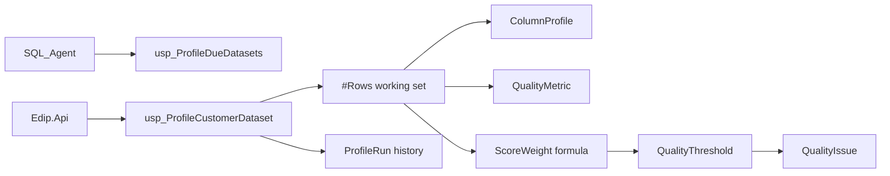

# SQL Data Quality Profiling & Analytics Engine

## Purpose
SQL Server profiling engine for **ingest datasets** (staged and/or processed records). Each run produces a unique `ProfileRunId`, column statistics, named metrics, quality issues, threshold evaluation, and a configurable overall score consumable via ADO.NET.

This complements — and does not replace — data-source profiling in `dq` (external catalog profiling).

## Architecture



## Schema (`profile`)

| Table | Role |
|-------|------|
| `DatasetProfile` | Per-dataset catalog + latest run pointer |
| `ProfileRun` | Unique run header + dataset-level metrics/score |
| `ColumnProfile` | Completeness, uniqueness, numeric/date/text stats |
| `QualityMetric` | Named metric values for dashboards |
| `QualityIssue` | Missing / duplicate / invalid / threshold issues |
| `QualityThreshold` | Configurable pass/fail rules (global or per dataset) |
| `ScoreWeight` | Dimension weights (single source of truth) |
| `ThresholdResult` | Per-run evaluation audit |

## Metrics

### Completeness (dataset + column)
- Total / Non-Null / Null records
- Null % and Completeness %
- Dataset completeness uses a 7-column cell matrix for CUSTOMER

### Uniqueness & duplicates
- Distinct key values and surplus duplicates on `ingest.Dataset.KeyColumn` (`CustomerCode`)
- Column-level distinct / duplicate value counts and percentages

### Validity
- Driven from `etl.EtlError` (validation/transform/load errors)
- Valid / Invalid records, validation error count, Validity %, Error %
- Issues grouped by dataset, import, column, error type

### Statistical profiling
| Category | Stats |
|----------|-------|
| Numeric (`CreditLimit`) | Min, Max, Avg, Median (`PERCENTILE_CONT`), StdDev, Distinct |
| Date (`CreatedDate`) | Min/Max date, Distinct date count |
| Text | Min/Max/Avg length, Min/Max value, Distinct |

### Consistency
Share of rows whose `Status` is in `etl.AllowedValue` and `CountryCode` exists in `ingest.Country`.

## Quality score formula

Weights live only in `profile.ScoreWeight` (global defaults; optional per-dataset overrides):

| Dimension | Default weight |
|-----------|----------------|
| Completeness | 30% |
| Validity | 30% |
| Uniqueness | 25% |
| Consistency | 15% |

```
OverallScore = Σ (DimensionPct × Weight) / Σ Weights
Grade: A≥90, B≥80, C≥70, D≥60, else F
```

Implemented via `profile.fn_GetWeight` + a single calculation block in `usp_ProfileCustomerDataset` — not duplicated across procedures.

## Thresholds
Default global rules (seeded):
- Completeness ≥ 90
- Validity ≥ 95
- Uniqueness ≥ 98
- Duplicate % ≤ 2
- Overall score ≥ 80

Evaluation uses `profile.fn_EvaluateThreshold`. Failed rules set `ThresholdResult = Fail` and emit `ThresholdBreach` issues.

## Historical tracking
Every successful run is retained. `profile.usp_GetQualityTrend` uses window `LAG()` for:
- Current vs previous Overall / Completeness / Validity / Duplicate %
- Delta columns for dashboards

## Performance notes
- One load of source rows into `#Rows`, then set-based aggregations (CTEs, window functions)
- Avoids per-column cursor scans of the fact table
- Indexes on `ProfileRun(DatasetId, StartedUtc)`, `ColumnProfile(ProfileRunId)`, `QualityIssue`, `QualityMetric`
- Agent profiles only enabled datasets, oldest-first

## Scheduling
`database/29_SqlAgentJobs_Profile.sql`:
- **EDIP_DatasetQualityProfile** — daily 03:00 — `usp_ProfileDueDatasets`
- **EDIP_ArchiveProfileHistory** — weekly — retain 180 days

Worker job types: `DatasetQualityProfile`, `ArchiveProfileHistory`.

## ADO.NET / API

```http
POST /api/dataset-profile/CUSTOMER?scope=Processed
GET  /api/dataset-profile/CUSTOMER/score
GET  /api/dataset-profile/runs/{profileRunId}
GET  /api/dataset-profile/runs/{profileRunId}/columns
GET  /api/dataset-profile/runs/{profileRunId}/issues
GET  /api/dataset-profile/runs/{profileRunId}/thresholds
GET  /api/dataset-profile/CUSTOMER/trend
POST /api/dataset-profile/process-due
```

Reports: `dataset-quality-summary`, `lowest-quality-datasets`, `top-quality-issues`, `dataset-quality-trend`, `failed-quality-thresholds`, `dataset-quality-comparison`, `import-quality-summary` (+ `/export?format=csv|xlsx`).

## Migration
Scripts `25`–`28` (in `00_DeployAll.sql` / `Deploy-Edip.ps1`). Optional Agent: `29_SqlAgentJobs_Profile.sql`.

## Known limitations
- CUSTOMER column map is explicit in T-SQL (extend with similar procs for new datasets, or drive from metadata later).
- Validity for pure `Processed` scope uses recent ETL errors as issues; invalid counts on curated rows default to 0 unless staging/import scoped.
- Median uses `PERCENTILE_CONT` (compatible with SQL Server 2012+).
- Report `dataset-quality-trend` via `/api/reports` defaults to `CUSTOMER`; use the profile API for other codes.

## Tests
See `samples/PROFILE_TEST_SCENARIOS.md`.
