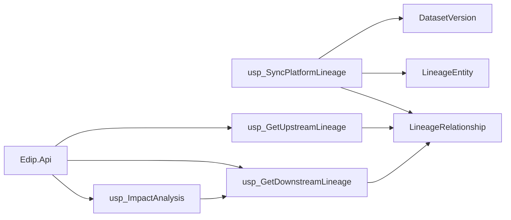

# SQL Lineage, Dependency & Impact Analysis Engine

## Purpose
SQL Server lineage graph for platform entities (sources, datasets, versions, imports, transformations, quality profile runs, analytics/report assets). Supports upstream/downstream traversal, impact analysis, version-aware queries, circular-dependency prevention, workspace filtering, and dashboard analytics — consumed via ADO.NET.

## Architecture

## Schema (`lineage`)

| Table | Role |
|-------|------|
| `EntityType` | Catalog of node kinds |
| `LineageEntity` | Polymorphic graph nodes with workspace + optional dataset/version |
| `DatasetVersion` | Append-only dataset version history (import/ETL/profile linkage) |
| `LineageRelationship` | Directed edges with type, versions, process reference |
| `LineageCaptureLog` | Sync/capture audit |

### Relationship types
`Feeds`, `ImportsInto`, `TransformsTo`, `Profiles`, `ReportsOn`, `DependsOn`, `DerivedFrom`, `Produces`

### Automatic recording
| Proc | Captures |
|------|----------|
| `usp_RecordImportLineage` | DataSource → Import → Dataset (+ version) |
| `usp_RecordEtlLineage` | Version → Transformation → Version |
| `usp_RecordProfileLineage` | Dataset/Version → QualityProfileRun |
| `usp_RecordAnalyticsLineage` | Dataset → AnalyticsAsset/Report |
| `usp_SyncPlatformLineage` | Rebuild from recent platform history |

## Recursive query strategy
- **Upstream**: recursive CTE walking `TargetEntityId → SourceEntityId` (incoming edges).
- **Downstream / Impact**: recursive CTE walking `SourceEntityId → TargetEntityId`.
- Cycle safety: path-key exclusion + `@MaxDepth` (capped at 100) + `OPTION (MAXRECURSION 100)`.
- Inserts call `usp_WouldCreateCycle` when `@PreventCycles = 1`.

## Version handling
`lineage.DatasetVersion` is append-only. Questions answered by `usp_GetVersionLineage`:
- Which source/import produced version N?
- Which ETL run generated a version?
- Immediate upstream/downstream edges for a version.

## Workspace isolation
All traversal and analytics procs accept `@WorkspaceId`:
- `NULL` = platform-wide (permitted cross-workspace view)
- Non-null = filter entities/edges belonging to that workspace (or null-workspace edges)

No RLS; isolation is parameter-driven (same pattern as analytics).

## Indexing / optimization
- Unique edge index on active relationships (duplicate prevention)
- Separate indexes on `SourceEntityId` and `TargetEntityId` for recursive joins
- Composite `(WorkspaceId, RelationshipType)` and `(WorkspaceId, EntityTypeCode)`
- Unique `(DatasetId, VersionNumber)` for version lookups
- Set-based sync with capped batch windows; avoid full-table recursion without depth limits

## ADO.NET / API

Route prefix: `/api/lineage`

| Endpoint | Purpose |
|----------|---------|
| `GET /upstream` | Upstream lineage |
| `GET /downstream` | Downstream dependents |
| `GET /impact` | Impact analysis |
| `GET /versions/{datasetCode}` | Version-aware lineage |
| `GET /circular` | Circular dependency detection |
| `POST /relationships` | Add edge (cycle-guarded) |
| `POST /sync` | Sync from platform |
| `GET /analytics/*` | Dashboard feeds |

Parameterized stored procedures, async ADO.NET, `CommandTimeout = 120`, `await using` disposal.

## Scheduling
- Jobs: `SyncPlatformLineage`, `ArchiveLineageHistory`
- Agent script: `database/39_SqlAgentJobs_Lineage.sql` (T-SQL subsystem)

## Deploy
Scripts `35`–`38` included in `00_DeployAll.sql` / `Deploy-Edip.ps1`. Optional: `39_SqlAgentJobs_Lineage.sql`, `40_Tests_Lineage.sql`.

## Known limitations
- CUSTOMER / demo assets are the primary automatic analytics seeds; additional datasets need sync or explicit `usp_RecordAnalyticsLineage`.
- Graph does not parse T-SQL text for column-level lineage (relationship-level only).
- Circular detection reports cycles; prevention is on insert, not auto-repair of legacy edges.
- Large graphs should keep `@MaxDepth` modest for interactive API calls.
