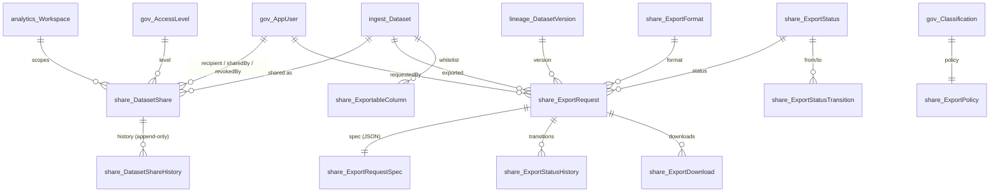

# SQL Data Sharing, Export & Secure Delivery Engine

Module scripts: `database/47_Schema_Sharing.sql` … `database/52_Tests_Sharing.sql`  
API: `api/sharing` (`SharingController` → `SharingService` → `SharingRepository`, ADO.NET)

The module adds controlled dataset sharing, export requests with a validated
state machine, database-side export authorization, server-side filtered and
paged export data, download tracking, and export reporting. It **reuses** the
existing platform structures instead of duplicating them:

| Existing structure | Used for |
|--------------------|----------|
| `ingest.Dataset` | Dataset catalog, `WorkspaceId`, `TargetTable` (export source) |
| `analytics.Workspace` | Workspace scoping / reporting |
| `gov.AppUser`, `gov.WorkspaceMember`, `gov.Role` | Users, same-workspace rule, RBAC role fallback |
| `gov.AccessLevel` | Share / policy access levels (Read < Write < Admin) |
| `gov.DatasetAccessGrant` | Approved grants count toward export authorization |
| `gov.DatasetGovernance`, `gov.Classification` | Classification, governance status, certification, owner/steward |
| `lineage.DatasetVersion` | Version an export was taken from (defaults to latest) |
| `gov.GovernanceAuditEvent` via `gov.usp_WriteAudit` | All share/export audit events (no new audit table) |

Existing data is untouched: the module only adds a `share` schema, new `rpt`
procedures/views, and two new job types on `CK_Job_Type`.

---

## 1. ERD



### Tables

| Table | Key columns | Notes |
|-------|-------------|-------|
| `share.DatasetShare` | ShareId, DatasetId, WorkspaceId, RecipientUserId, AccessLevelCode, SharedByUserId, SharedUtc, ExpiresUtc, Status, RevokedByUserId, RevokedUtc, RevokeReason | `Status` ∈ Active/Revoked/Expired. Filtered unique index = one **active** share per dataset + recipient. Checks: no self-share, expiry after share date, revoked rows must carry revoker + date. |
| `share.DatasetShareHistory` | ShareHistoryId, ShareId, Action (Created/Updated/Revoked/Expired), previous/new status, level, expiry, ActorUserId | Append-only. |
| `share.ExportRequest` | ExportRequestId, DatasetId, DatasetVersionId, RequestedByUserId, WorkspaceId, FormatCode, Status, AccessSource, Requested/Started/CompletedUtc, RecordCount, FileSizeBytes, FileReference, FailureReason, AttemptCount | Narrow header — no large payloads. `FileReference` is a storage key, never file content. |
| `share.ExportRequestSpec` | ExportRequestId (1:1), SelectedColumnsJson, FiltersJson, SortJson, SpecHash | JSON kept off the header so queue/report scans stay narrow. `ISJSON` checks. |
| `share.ExportStatusHistory` | ExportRequestId, PreviousStatus, NewStatus, ActorUserId, ChangedUtc, Message | Append-only. |
| `share.ExportDownload` | ExportRequestId, DownloadedByUserId, DownloadedUtc, ClientInfo | Download log. |
| `share.ExportFormat` | Csv, Xlsx, Json, Parquet (+ MIME type / extension) | |
| `share.ExportStatus` / `share.ExportStatusTransition` | Status catalog + allowed transitions | Drives the state machine. |
| `share.ExportPolicy` | ClassificationCode → MinAccessLevelCode, RequireCertified, AllowWorkspaceRoleExport | Configurable, not hard-coded. |
| `share.ExportableColumn` | DatasetId, ColumnName, SqlTypeDeclaration, IsKey, IsFilterable, IsSortable, IsExportable | Synced from `sys.columns` of the dataset target table; admins can disable columns (sync preserves `IsExportable = 0`). |

---

## 2. Status model

### Export requests

```
Pending ──► Processing ──► Completed   (terminal)
   │            │
   │            ├──► Failed ──► Pending   (retry, max 3 attempts)
   │            │
   └──► Cancelled ◄─┘                    (terminal)
```

`share.usp_TransitionExportStatus` is the only way to change status. It rejects
transitions not in `share.ExportStatusTransition` (`InvalidTransition`), uses
optimistic concurrency (`UPDATE … WHERE Status = @Current` → `ConcurrencyConflict`),
requires `RecordCount` for Completed and `FailureReason` for Failed, and
**re-authorizes the requester when processing starts**: if access was lost
since submission, the request is auto-cancelled and `AccessDenied` is returned.

### Shares — effective status

`share.vw_DatasetShareEffective.EffectiveStatus` computes
`Active` + `ExpiresUtc <= now` ⇒ `Expired` **at read time**. Authorization,
listings and reports use the effective status, so expiry is enforced even if
the expiry job hasn't run, and reads never write history. The scheduled
`share.usp_ExpireDatasetShares` later persists `Expired`, writes history
(`Action = Expired`) and an audit event. `usp_GetExpiredShares` returns
`IsMarked` so admins can see not-yet-persisted expiries.

---

## 3. Export authorization

`share.fn_EvaluateExportAccess(@DatasetId, @UserId)` (inline TVF — used by
procedures, `share.usp_EvaluateExportAccess`, and `rpt.vw_UserDatasetExportAccess`).
It complements, not replaces, application authorization.

Decision order (first failing rule wins):

| # | Rule | DecisionCode |
|---|------|--------------|
| 1 | Dataset inactive | `DatasetInactive` |
| 2 | User inactive | `UserInactive` |
| 3 | Governance status `Archived` | `DatasetArchived` |
| 4 | Not platform admin and not an active member of the dataset workspace | `CrossWorkspaceDenied` |
| 5 | Policy requires certification and dataset not `Certified` (non-admin) | `NotCertified` |
| 6 | Effective access rank < policy minimum | `InsufficientAccess` |
| – | Otherwise | `Allowed` |

Effective access = highest of:

- Platform admin / dataset owner / dataset steward → Admin
- Active, unexpired `gov.DatasetAccessGrant`
- Active, unexpired `share.DatasetShare`
- Workspace role (only if policy `AllowWorkspaceRoleExport = 1`): WorkspaceAdmin/DataOwner → Admin, DataSteward/Analyst → Read, Viewer → Read on Public only

Default policy:

| Classification | Min level | Requires certified | Workspace role counts |
|----------------|-----------|--------------------|-----------------------|
| Public | Read | No | Yes |
| Internal | Read | No | Yes |
| Confidential | Write | Yes | No |
| Restricted | Admin | Yes | No |

The result also returns `AccessSource` (PlatformAdmin, DatasetOwner,
DatasetSteward, AccessGrant, DatasetShare, WorkspaceRole), `GrantStatus` and
`ShareStatus` (Active/Expired/Revoked/None), classification, governance and
certification status, and the required vs effective level.

Authorization is checked at **submit**, **processing start**, **every data
page read**, and **download**.

Who can manage shares (`share.fn_CanManageDatasetShares`): platform admins,
dataset owner/steward, and workspace members with role WorkspaceAdmin,
DataOwner or DataSteward. Recipients must be active members of the dataset
workspace (same-workspace rule) unless they are platform admins.

---

## 4. Procedure contracts (ADO.NET)

All mutating procedures use `@StatusCode NVARCHAR(32) OUTPUT` and
`@StatusMessage NVARCHAR(500) OUTPUT` (same pattern as governance). A result
set is returned **only on success**; output parameters are readable after the
data reader is closed.

### Sharing

| Procedure | Parameters | Result set | Status codes |
|-----------|------------|------------|--------------|
| `share.usp_CreateDatasetShare` | DatasetCode, RecipientUserName, AccessLevelCode, SharedByUserName, ExpiresUtc?, Notes?, **@ShareId OUT** | share row (`vw_DatasetShareDetail`) | Created · InvalidDataset · DatasetArchived · InvalidRecipient · InvalidUser · SelfShare · InvalidAccessLevel · InvalidExpiry · Unauthorized · CrossWorkspaceDenied · DuplicateActive (`@ShareId` = existing) |
| `share.usp_UpdateDatasetShare` | ShareId, ActorUserName, AccessLevelCode?, ExpiresUtc?, ClearExpiry, Comments? | share row | Updated · NoChange · NotFound · ShareRevoked · ShareExpired · InvalidUser · Unauthorized · InvalidAccessLevel · InvalidExpiry · ConcurrencyConflict |
| `share.usp_RevokeDatasetShare` | ShareId, ActorUserName, RevokeReason? | share row | Revoked · NotFound · AlreadyRevoked · AlreadyExpired · InvalidUser · Unauthorized · ConcurrencyConflict |
| `share.usp_GetShare` / `usp_GetActiveShares` | ShareId / DatasetCode?, RecipientUserName?, WorkspaceId? | share rows | – |
| `share.usp_GetShares` | filters + EffectiveStatus?, PageNumber, PageSize (≤500) | share rows + `TotalCount` | – |
| `share.usp_GetExpiredShares` | WorkspaceId?, OnlyUnmarked | share rows + `IsMarked` | – |
| `share.usp_GetShareHistory` | ShareId?, DatasetCode?, RecipientUserName?, Take (≤1000) | history rows | – |
| `share.usp_ExpireDatasetShares` | – | `ExpiredCount` | – |

### Exports

| Procedure | Parameters | Result set(s) | Status codes |
|-----------|------------|---------------|--------------|
| `share.usp_EvaluateExportAccess` | DatasetCode, UserName | 1 decision row | – |
| `share.usp_GetExportableDatasetsForUser` | UserName, WorkspaceId? | decision per dataset | – |
| `share.usp_GetExportableColumns` / `usp_SyncExportableColumns` | DatasetCode(?) | columns / summary | – |
| `share.usp_SubmitExportRequest` | DatasetCode, UserName, FormatCode, DatasetVersionId?, SelectedColumnsJson?, FiltersJson?, SortJson?, **@ExportRequestId OUT** | request row | Created · InvalidDataset · InvalidUser · InvalidFormat · InvalidVersion · AccessDenied · NoExportableColumns · InvalidSpec · InvalidColumn · InvalidOperator · InvalidFilterValue · DuplicateInFlight |
| `share.usp_TransitionExportStatus` | ExportRequestId, NewStatus, ActorUserName? (NULL = worker), RecordCount?, FileSizeBytes?, FileReference?, FailureReason? | request row | *NewStatus* on success · NotFound · InvalidStatus · InvalidTransition · InvalidUser · Unauthorized · RecordCountRequired · FailureReasonRequired · RetryLimitReached · AccessDenied · ConcurrencyConflict |
| `share.usp_ClaimNextExportRequest` | – | request row if claimed | Processing · QueueEmpty · AccessDenied |
| `share.usp_GetExportRequest` | ExportRequestId | (1) request + spec JSON, (2) status history, (3) downloads | – |
| `share.usp_GetExportData` | ExportRequestId, UserName?, PageSize (≤50 000), PageNumber, AfterKey?, IncludeTotalCount | (1) data rows, (2) paging row | OK · NotFound · InvalidUser · Unauthorized · InvalidState · AccessDenied · TargetMissing · NoExportableColumns · InvalidSpec · InvalidAfterKey |
| `share.usp_RecordExportDownload` | ExportRequestId, UserName, ClientInfo? | file metadata (MIME, extension, FileReference) | Downloaded · NotFound · NotCompleted · InvalidUser · Unauthorized · AccessDenied |
| `share.usp_GetExportHistory` | UserName?, DatasetCode?, WorkspaceId?, Status?, FormatCode?, FromUtc?, ToUtc?, PageNumber, PageSize (≤500) | rows + `TotalCount` + `DownloadCount` | – |
| `share.usp_CleanupStaleExports` | ProcessingTimeoutMinutes, PendingTimeoutHours | `TimedOutCount`, `AbandonedCount` | – |

### Reports

| Procedure | Output |
|-----------|--------|
| `rpt.usp_ExportSummary` (WorkspaceId?, FromUtc?, ToUtc?) | totals: all / completed / failed / pending / processing / cancelled, records exported, avg duration, requesters, datasets, downloads, active / expired / revoked shares |
| `rpt.usp_ExportsByFormat` / `usp_ExportsByDataset` / `usp_ExportsByUser` | per-key totals, completed, failed, in-flight, records, last requested |
| `rpt.usp_ExportActivityByDate` (Days, WorkspaceId?) | one row per day (gap-filled): requested, completed, failed, cancelled, in-flight, records, downloads |
| `rpt.usp_ShareStatusSummary` (WorkspaceId?) | per dataset: active, expired, revoked, expiring within 7 days, expired-not-yet-marked |

Views: `rpt.vw_ActiveDatasetShares`, `rpt.vw_DatasetShareStatus`,
`rpt.vw_PendingExportQueue`, `rpt.vw_FailedExports`, `rpt.vw_ExportDailyActivity`,
`rpt.vw_UserDatasetExportAccess` (authorization matrix for admin review).

### Export spec JSON

```json
{
  "selectedColumns": ["CustomerId", "CustomerName", "CountryCode"],
  "filters": [
    { "column": "CountryCode", "op": "in", "value": ["US", "UK"] },
    { "column": "CreditLimit", "op": "between", "value": [1000, 20000] },
    { "column": "Email", "op": "notnull" }
  ],
  "sort": [{ "column": "CreditLimit", "dir": "desc" }]
}
```

Operators: `eq ne gt ge lt le like in between isnull notnull`. Limits: 20
filters, 1–1000 `in` values, 5 sort columns. Values must convert to the
column's SQL type (checked with `TRY_CONVERT` at submit → `InvalidFilterValue`).

### ADO.NET example

```csharp
await using var cmd = new SqlCommand("share.usp_GetExportData", conn)
    { CommandType = CommandType.StoredProcedure, CommandTimeout = 120 };
cmd.Parameters.AddWithValue("@ExportRequestId", id);
cmd.Parameters.AddWithValue("@PageSize", 5000);
cmd.Parameters.AddWithValue("@AfterKey", (object?)afterKey ?? DBNull.Value);
var code = cmd.Parameters.Add(new SqlParameter("@StatusCode", SqlDbType.NVarChar, 32)
    { Direction = ParameterDirection.InputOutput, Value = DBNull.Value });

await using (var reader = await cmd.ExecuteReaderAsync(CommandBehavior.SequentialAccess, ct))
{
    while (await reader.ReadAsync(ct)) { /* stream row to file writer */ }
    if (await reader.NextResultAsync(ct) && await reader.ReadAsync(ct))
        nextAfterKey = reader.IsDBNull(6) ? null : reader.GetString(6);   // NextAfterKey
}
// read code.Value only after the reader is disposed
```

Worker loop: `usp_ClaimNextExportRequest` → loop `usp_GetExportData` until
`HasMore = 0` (passing `NextAfterKey`) → write file → `usp_TransitionExportStatus`
(Completed with `RecordCount`, `FileReference`) or Failed with `FailureReason`.

---

## 5. Large dataset support & performance analysis

**Server-side filtering / column selection.** `usp_GetExportData` builds one
parameterized `sp_executesql` statement:

- Table name from `OBJECT_ID(TargetTable)` → `QUOTENAME(schema).QUOTENAME(table)`.
- Column, filter and sort names only from `share.ExportableColumn` (whitelist
  join) and wrapped in `QUOTENAME`. Operators map to fixed SQL fragments.
- Filter **values never enter SQL text**: each is read inside the dynamic
  batch with `JSON_VALUE(@FiltersJson, '$[n].value')` into a local variable
  typed from the catalog (`DECLARE @v0 nvarchar(64) = TRY_CONVERT(...)`), so
  predicates are sargable (`[CountryCode] = @v0`) and injection-safe.
- Only the selected columns are read — no `SELECT *`.

**Paging.**

| Mode | When | Cost |
|------|------|------|
| Keyset | Dataset has a single-column PK and no custom sort (or sort = key ASC) | `WHERE key > @k ORDER BY key` + `TOP (@PageSize)` → clustered index seek; constant cost per page regardless of depth. `NextAfterKey` / `HasMore` computed with seeks. |
| Offset | Custom sort | `OFFSET/FETCH` with the key appended as a tie-breaker for deterministic pages; cost grows with depth — fine for previews, use keyset for full exports. |

`IncludeTotalCount` is opt-in because `COUNT_BIG(*)` scans the filtered set.
Page size is capped at 50 000 rows; `CommandBehavior.SequentialAccess` streams
rows without buffering.

**Indexes (all created in `47_Schema_Sharing.sql`).**

| Index | Serves |
|-------|--------|
| `UX_Share_ActiveRecipient (DatasetId, RecipientUserId) WHERE Status='Active'` | Duplicate-active prevention, active-share auth lookup |
| `IX_Share_Recipient_Auth (RecipientUserId, DatasetId, Status) INCLUDE (AccessLevelCode, ExpiresUtc)` | `fn_EvaluateExportAccess` share probe (covering) |
| `IX_Share_Expiry (ExpiresUtc) WHERE Status='Active' AND ExpiresUtc IS NOT NULL` | Expiry job / expired-share listing — tiny filtered index |
| `IX_Share_Workspace_Status`, `IX_Share_Dataset_Status`, `IX_Share_Level` | Workspace / dataset / access-level listings and reports |
| `IX_ExportReq_Status_Requested (Status, RequestedUtc)` | Queue pickup (`UPDLOCK, READPAST`), status reports |
| `IX_ExportReq_User_Requested`, `_Dataset_Requested`, `_Workspace_Requested`, `_Format_Requested`, `_Requested` | History by user / dataset / workspace / format / date (all DESC for latest-first paging) |
| `IX_ExportStatusHist_Request`, `IX_ExportDownload_Request/_User`, `IX_ShareHist_*` | Detail and history lookups |
| existing `IX_AccessGrant_User_Active (UserId, IsActive) INCLUDE (DatasetId, AccessLevelCode, ExpiresUtc)` | Grant probe in authorization (reused, no new index) |

**Other choices.**

- `usp_GetExportHistory` pages the narrow header first (`COUNT(*) OVER()` +
  `OFFSET/FETCH` on keys) and joins display columns for the page only.
  Catch-all filters use `OPTION (RECOMPILE)` to get a plan per filter shape.
- The JSON spec lives in `ExportRequestSpec`, so status/report scans never
  read `NVARCHAR(MAX)` pages.
- Authorization is an inline TVF, so the optimizer inlines it (no scalar-UDF
  row-by-row execution) — including in the `CROSS APPLY` matrix view.
- Queue claim uses `UPDLOCK, READPAST, ROWLOCK` so concurrent workers never
  claim the same request.

---

## 6. Audit integration

Written to `gov.GovernanceAuditEvent` through `gov.usp_WriteAudit`
(`UserId` = subject/requester, `ActorUserId` = actor, IDs in `DetailsJson`):

| EventType | Raised by |
|-----------|-----------|
| ShareCreated / ShareModified / ShareRevoked | create / update / revoke procs |
| ShareExpired | `usp_ExpireDatasetShares` (actor NULL = system) |
| ExportRequested / ExportDenied | submit (denied submits are audited, not stored as requests) |
| ExportStarted / ExportCompleted / ExportFailed / ExportCancelled / ExportRetried | `usp_TransitionExportStatus`, cleanup job |
| ExportDownloaded / ExportDenied (stage = download) | `usp_RecordExportDownload` |

Query with `GET /api/governance/audit?eventType=ExportCompleted`.

---

## 7. Scheduling

| Job type (platform scheduler) | SQL Agent job (`51_SqlAgentJobs_Sharing.sql`) | Procedure |
|-------------------------------|-----------------------------------------------|-----------|
| `ExpireDatasetShares` (hourly) | `EDIP_ExpireDatasetShares` (hourly) | `share.usp_ExpireDatasetShares` |
| `CleanupStaleExports` (every 15 min) | `EDIP_CleanupStaleExports` (every 15 min) | `share.usp_CleanupStaleExports` (Processing > 120 min → Failed, Pending > 72 h → Cancelled) |

---

## 8. Sample data & tests

`50_Seed_Sharing.sql` (idempotent):

- Shares: CUSTOMER → gov.viewer (Read, active, +30 days); ORDER → gov.viewer
  (Write, backdated so it is **effectively expired** but not yet marked);
  ORDER → gov.analyst (revoked).
- Exports: analyst CUSTOMER Csv (Completed + downloaded), owner Json (Failed),
  owner Parquet (Cancelled), analyst Xlsx (Pending), viewer Csv (AccessDenied, audited).
- Platform jobs `Expire Dataset Shares` and `Cleanup Stale Exports`.

`52_Tests_Sharing.sql` runs 53 assertions (authorization sources and denials,
share validation and lifecycle, spec validation incl. injection attempts,
full export lifecycle, keyset/offset paging, downloads, history, audit, report
consistency) and raises an error if any fail. Re-runnable. See
[samples/SHARING_TEST_SCENARIOS.md](../samples/SHARING_TEST_SCENARIOS.md) for
the API walkthrough.
