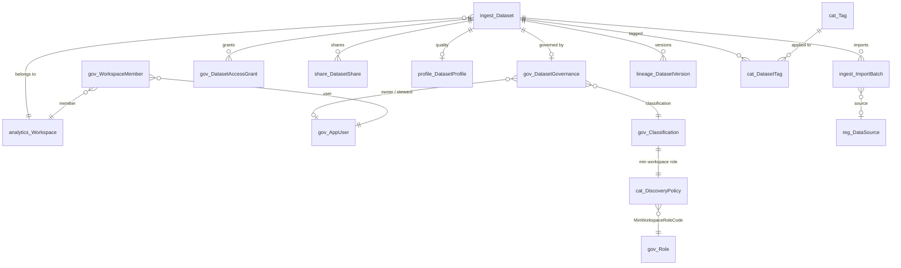

# SQL Data Catalog, Discovery & Metadata Search Engine

Module scripts: `database/53_Schema_Catalog.sql` … `database/58_Perf_Catalog.sql`  
API: `api/catalog` (`CatalogController` → `CatalogService` → `CatalogRepository`, ADO.NET)

The catalog is a **query layer over the existing platform tables**. There is no
catalog dataset table: every catalog row is assembled at query time from
`ingest.Dataset` plus governance, quality, lineage, import and tag data, and is
filtered by the requesting user's access. Search runs entirely in SQL Server
(parameterized `LIKE` + deterministic relevance), with no external search engine
and no dynamic SQL.

| Script | Purpose | In `00_DeployAll.sql` |
|--------|---------|-----------------------|
| `53_Schema_Catalog.sql` | `cat` schema, `cat.Tag`, `cat.DatasetTag`, `cat.DiscoveryPolicy`, one filtered index | Yes |
| `54_Procs_Catalog.sql` | Discovery + search TVFs, search / detail / tag procedures, 8 report procedures | Yes |
| `55_Views_Catalog.sql` | `cat.vw_DatasetCatalog`, `cat.vw_TagUsage`, `rpt.vw_UserDatasetDiscovery` | Yes |
| `56_Seed_Catalog.sql` | 3 demo datasets + tags for all 7 demo datasets (idempotent) | Yes |
| `57_Tests_Catalog.sql` | 99 assertions (re-runnable) | No |
| `58_Perf_Catalog.sql` | 20,000-dataset benchmark inside a rolled-back transaction | No (manual) |

## Reused structures

| Existing structure | Catalog field / use |
|--------------------|---------------------|
| `ingest.Dataset` | Name (`DisplayName`), Code, Description, Category, Dataset Status, `IsActive`, Created/Updated (`CreatedUtc`/`ModifiedUtc`), legacy text owner (`OwnerName`) |
| `analytics.Workspace` | Workspace code / name |
| `gov.DatasetGovernance` | Classification, Governance Status, Certification Status, Owner/Steward user, governed workspace |
| `gov.AppUser`, `gov.WorkspaceMember` | Owner/steward names, requesting user, workspace membership + role (RBAC) |
| `gov.Classification`, `gov.GovernanceStatus`, `gov.CertificationStatus`, `gov.AccessLevel` | Display names, sensitivity rank, sort order, access ranks |
| `gov.DatasetAccessGrant`, `share.DatasetShare` | Cross-workspace discovery via active grants / shares |
| `profile.DatasetProfile` / `profile.ProfileRun` | Quality score (`LatestOverallScore`), grade, dimension percentages |
| `ingest.ImportBatch` → `reg.DataSource` → `reg.DataSourceType` | Last import date / status, source type (latest batch with a registered source) |
| `lineage.DatasetVersion`, `lineage.LineageEntity` / `LineageRelationship` | Current version, version history, upstream/downstream summary |
| `gov.CertificationHistory` | Certification history (detail, opt-in) |
| `share.fn_CanManageDatasetShares` | Who may add/remove tags (same managers as sharing) |
| `gov.usp_WriteAudit` | `DatasetTagged` / `DatasetUntagged` audit events |

> **Tags:** no dataset/tag relationship existed anywhere in the platform
> (`docs/01` only listed a future `meta.Tag`). `cat.Tag` + `cat.DatasetTag` are
> therefore the platform's **single** tag structure; nothing else stores tags.

New objects are limited to the `cat` schema (2 tag tables + 1 policy table),
`rpt` report procedures/views, and one filtered index on `ingest.ImportBatch`.

---

## 1. ERD



### New tables

| Table | Key columns | Notes |
|-------|-------------|-------|
| `cat.Tag` | TagId (identity), TagName (unique), Description, IsActive, CreatedByUserId, CreatedUtc | `CK`: lower-case, trimmed, non-empty, no commas. Procedures additionally restrict names to `[a-z0-9._-]{1,64}`. |
| `cat.DatasetTag` | PK (DatasetId, TagId), TaggedByUserId, TaggedUtc | `IX_CatDatasetTag_Tag (TagId, DatasetId)` for tag → datasets. |
| `cat.DiscoveryPolicy` | ClassificationCode (PK), MinWorkspaceRoleCode (FK `gov.Role`) | Minimum workspace role that can *discover* a dataset of that classification. |

---

## 2. Access-aware discovery (`cat.fn_DatasetDiscovery`)

Inline TVF `cat.fn_DatasetDiscovery(@UserId, @IsPlatformAdmin, @IncludeInactive)`
returns one row per dataset the user may **see in the catalog**. Every
catalog procedure, view and report goes through it, so search, detail, tag
counts and reports always agree.

A dataset is discoverable when the active user is:

1. a platform admin, the dataset owner or the dataset steward, or
2. the holder of an active, unexpired `gov.DatasetAccessGrant` or `share.DatasetShare` (from any workspace), or
3. an active member of the dataset's workspace whose role rank meets `cat.DiscoveryPolicy` for its classification.

| Classification | Minimum workspace role to discover |
|----------------|------------------------------------|
| Public | Viewer |
| Internal | Viewer |
| Confidential | Analyst |
| Restricted | DataOwner |

Role ranks: Viewer 1 < Analyst 2 < DataSteward 3 < DataOwner 4 < WorkspaceAdmin 5.
The dataset workspace is `COALESCE(DatasetGovernance.WorkspaceId, Dataset.WorkspaceId)`,
consistent with the governance and sharing modules. **Members of other
workspaces never see a dataset unless a grant or share exists.**

Non-current datasets (`IsActive = 0`, DatasetStatus Inactive/Archived, or
governance status Archived) are visible only to admins, owners and stewards,
and only with `@IncludeInactive = 1`.

Each row also carries:

- **AccessSource:** PlatformAdmin, DatasetOwner, DatasetSteward, AccessGrant, DatasetShare or WorkspaceRole.
- **EffectiveAccessLevel:** the *data* access level (Read/Write/Admin, or NULL). It mirrors `gov.usp_EvaluateDatasetAccess`, plus active shares.
- **CanReadData:** whether the user can read the data.
- **CanRequestAccess:** set when the dataset is visible but the user has no data access (metadata only).

This is **defense in depth**: the API still authenticates and authorizes the
caller, and the SQL layer guarantees a user can't discover datasets outside
their access even if a caller passes arbitrary filters.

**Plan shape.** The function has two branches, selected by `@IsPlatformAdmin`.
Under the procedures' `OPTION (RECOMPILE)` the unused branch is removed at
compile time; without `RECOMPILE` a startup filter skips it at run time.

- **Admin branch:** returns every dataset with no per-row access evaluation.
- **Non-admin branch:** first gathers candidates per access path: member workspaces (via `IX_Dataset_Analytics` and `IX_DG_Workspace_Class`), grants, shares, owner and steward. It evaluates only those candidates, so cost grows with what the user can reach rather than with catalog size.

Callers resolve the active user once and pass `gov.AppUser.IsPlatformAdmin`.
Passing 0 for an admin only narrows the result to that admin's non-admin access.

---

## 3. Search, filters, relevance (`cat.fn_CatalogSearch`, `cat.usp_SearchCatalog`)

### Search text

The search text is trimmed and then escaped: `[`, `%` and `_` are bracketed, so
user input can never act as a wildcard. It is matched with
`COLLATE SQL_Latin1_General_CP1_CI_AS` (the database collation), which makes
matching **case-insensitive** and **partial**.

Fields searched: name, code, description, tags, category, owner and steward
(user name, display name or legacy text owner), and source type (code or
display name). All values are parameters, so there is no dynamic SQL.

### Deterministic relevance (Name > Code > Tags > Description)

| Field | Exact | Prefix | Contains |
|-------|------:|-------:|---------:|
| Name | 1000 | 900 | 800 |
| Code | 700 | 650 | 600 |
| Tag | 500 | — | 450 |
| Description | — | — | 300 |
| Category | — | — | 200 |
| Owner / steward | — | — | 150 |
| Source type | — | — | 100 |

`RelevanceScore` = best field score + (number of other matching fields).
The tie-breakers are name and then DatasetId, so the order is fully deterministic.
For example, searching "customer" gives CUSTOMER 904, INVOICE 900, COUNTRY 301 and ORDER 150.

### Filters (all optional, all composable)

| Parameter | Matches |
|-----------|---------|
| `@WorkspaceCode` | Effective workspace |
| `@Category` | Exact |
| `@ClassificationCode`, `@GovernanceStatusCode`, `@CertificationStatusCode`, `@DatasetStatus` | Exact |
| `@OwnerUserName`, `@StewardUserName` | Governance owner / steward. The owner filter falls back to the legacy `Dataset.OwnerName` text when no user matches. |
| `@SourceTypeCode` | Source type of the latest import that has a registered source |
| `@MinQualityScore`, `@MaxQualityScore` | Inclusive range |
| `@CreatedFrom`/`@CreatedTo`, `@UpdatedFrom`/`@UpdatedTo` | From inclusive, To exclusive |
| `@Tags` (≤ 10, CSV) + `@TagMatch` Any/All | Tag filter |
| `@IncludeInactive` | Privileged users only. Set automatically when filtering Archived/Inactive. |

Filters are written as `(@p IS NULL OR …)` predicates and statements run with
`OPTION (RECOMPILE)`, so unused filters vanish from the plan. Tag, people,
source-type and last-import matching are **set-based joins** that run once per
query, not per-row lookups (see §8).

### Sorting and paging

`@SortBy` accepts Relevance, Name, Code, CreatedDate, UpdatedDate,
QualityScore, LastImportDate, Classification and GovernanceStatus. Any other
value returns `InvalidSort`. `@SortDirection` is ASC or DESC.

The default sort is Relevance when search text is given and Name otherwise.
Each sort has its natural default direction: descending for dates, quality and
relevance. The ORDER BY is static, built from `CASE` branches, and DatasetId is
always the final tie-breaker.

- **OFFSET paging:** `@PageNumber` and `@PageSize` (1–200, default 25). The query fetches `PageSize + 1` rows to compute `@HasMore`. Pass `@IncludeTotalCount = 0` to skip the count query for infinite scroll.
- **Keyset paging:** available for the Name, Code, CreatedDate and UpdatedDate sorts. Pass `@AfterValue` and `@AfterDatasetId` from the previous page's `@NextAfterValue` and `@NextAfterDatasetId`.
- **Two-phase execution:** phase one stores only the page keys in a table variable. Phase two enriches just those ≤ 200 rows with version, tags, source, owner and steward.

No query uses `SELECT *`.

---

## 4. Consolidated dataset detail (`cat.usp_GetDatasetDetail`)

A missing dataset and an undiscoverable dataset both return `NotFound`, so a
caller can't learn whether a dataset exists. On success the procedure returns
seven result sets, always in this order:

| # | Result set | Content |
|---|------------|---------|
| 1 | Summary | Metadata, workspace, governance (classification, status, certification dates), owner/steward with e-mail, current version + count, source, quality (score, grade, dimension %), last import + 30-day failures, the caller's access (`AccessSource`, `EffectiveAccessLevel`, `CanReadData`, `CanRequestAccess`, `HasPendingAccessRequest`). Dataset-wide grant/share/pending counts appear **only for admins/owners/stewards**. |
| 2 | Tags | Name, description, tagged by / when |
| 3 | Recent imports | Latest `@RecentImportCount` batches (default 5, max 50) |
| 4 | Lineage summary | Pipeline entity count, upstream / downstream entity, source, dataset and consumer counts, last lineage date |
| 5 | Lineage neighbours | Up to `@LineageNeighborLimit` (default 20) direct neighbours |
| 6 | Version history | Empty unless `@IncludeHistory = 1` (`@HistoryCount`, default 10) |
| 7 | Certification history | Empty unless `@IncludeHistory = 1` |

History is opt-in, so the default call stays small.

---

## 5. Tags

| Procedure | Purpose | Status codes |
|-----------|---------|--------------|
| `cat.usp_GetTags(@UserName, @Search, @IncludeUnused)` | Tags with the count of **discoverable** datasets carrying each tag | OK, InvalidUser |
| `cat.usp_AddDatasetTags(@DatasetCode, @Tags, @UserName)` | Adds ≤ 20 tags, creating missing tags (`UPDLOCK, HOLDLOCK`) and writing a `DatasetTagged` audit event. Returns the dataset's tags. | Tagged, NoChange, InvalidDataset, InvalidUser, Unauthorized, InvalidTag |
| `cat.usp_RemoveDatasetTags(@DatasetCode, @Tags, @UserName)` | Removes tags and writes a `DatasetUntagged` audit event. Returns the remaining tags. | Untagged, NoChange, InvalidDataset, InvalidUser, Unauthorized, InvalidTag |

Tag managers are the users allowed by `share.fn_CanManageDatasetShares`:
platform admins, dataset owners and stewards, and workspace admins, owners and
stewards. Tags are normalized by `cat.fn_ParseTagList`: trimmed, lower-cased
and de-duplicated. Search supports a single-tag filter, a multi-tag filter
(Any or All), search by tag text, and returns each dataset's tags as a sorted
list.

---

## 6. Summary reports (`rpt` schema)

All report procedures take `@UserName` and an optional `@WorkspaceCode`, and
count only datasets the user can discover. An unknown or inactive user gets
zero counts or empty lists.

| Procedure | Output |
|-----------|--------|
| `rpt.usp_CatalogSummary` | TotalDiscoverable, Readable / MetadataOnly, Certified / Uncertified, Profiled, AvgQualityScore, Tagged, WorkspaceCount, UpdatedLast7Days, ImportedLast7Days, Deprecated |
| `rpt.usp_CatalogByClassification` | Every active classification (zero rows included) |
| `rpt.usp_CatalogByGovernanceStatus` | Every active governance status |
| `rpt.usp_CatalogByCategory` | Count, certified count, average quality per category |
| `rpt.usp_CatalogCertification` | Certified vs uncertified, by certification status, with % |
| `rpt.usp_CatalogQualityDistribution` | Excellent ≥ 90, Good ≥ 75, Fair ≥ 50, Poor, NotProfiled |
| `rpt.usp_CatalogRecentlyUpdated` / `rpt.usp_CatalogRecentlyImported` | `@Days` (30), `@Top` (10, max 100) |

Views:
- `cat.vw_DatasetCatalog`: platform-wide catalog for admin and ETL use. It applies no access filter.
- `cat.vw_TagUsage`: tag usage.
- `rpt.vw_UserDatasetDiscovery`: the user × dataset discovery matrix, for reviewing access decisions.

---

## 7. Index evaluation

The existing indexes were evaluated first, and **all of the catalog's lookups are served by them**:

| Need | Existing index used |
|------|---------------------|
| Code lookup (detail, tags) | `UX_Dataset_Code` |
| Workspace candidates | `IX_Dataset_Analytics (WorkspaceId, DatasetStatus) INCLUDE (…)`, `IX_DG_Workspace_Class` |
| Created / updated sort and filter | `IX_Dataset_Created`, `IX_Dataset_Modified` |
| Governance / certification filters | `IX_DG_GovStatus`, `IX_DG_CertStatus_Expiry`, `IX_DG_Owner`, `IX_DG_Steward` |
| Last import per dataset | `IX_ImportBatch_Analytics (DatasetId, ImportUtc) INCLUDE (Status, …)` |
| Current version | `UX_DatasetVersion_Dataset_Number` |
| Quality | `UQ (DatasetId)` on `profile.DatasetProfile` |
| User memberships / grants / shares | `IX_WsMember_User`, `IX_AccessGrant_User_Active`, `IX_Share_Recipient_Auth` |

| Index | Decision | Evidence (20k datasets, 100k batches) |
|-------|----------|----------------------------------------|
| `IX_ImportBatch_Dataset_Source ON ingest.ImportBatch (DatasetId, ImportUtc DESC) INCLUDE (DataSourceId) WHERE DataSourceId IS NOT NULL` | **Added** | Search: 9,614 vs 11,525 reads (−17%), 648 vs 754 ms. Source filter: 8,701 vs 10,249 reads (−15%), 248 vs 307 ms. It is filtered to batches that have a registered source, so it stays small and costs little to maintain. |
| `(DisplayName, DatasetId) INCLUDE (…)` on `ingest.Dataset` | **Rejected** | Page 1: 6,155 vs 6,355 reads (no gain). Keyset page: 4,087 vs 4,609 (−11%). That doesn't justify a second wide index on the dataset table. It stays in `58_Perf_Catalog.sql`, created and rolled back inside the transaction, so the decision is reproducible. |
| `IX_ImportBatch_Dataset_Import` (pre-existing) | Not touched | Same key as `IX_ImportBatch_Analytics`, so it is redundant. It is flagged here as a candidate for removal by its owning module. |

---

## 8. Performance analysis (large catalog)

`58_Perf_Catalog.sql` builds a synthetic catalog inside one transaction:
- 20 workspaces and 20,000 datasets.
- Governance rows with mixed classifications and statuses.
- Quality scores on 70% of datasets.
- 100,000 import batches, with a registered source on 1 in 5 datasets.
- 50 tags, with 3 tags per dataset.

It then measures each scenario (logical reads from `sys.dm_exec_requests` and
elapsed time), evaluates the indexes, and **rolls everything back**.

| Scenario | Logical reads | ms | Rows / total |
|----------|-------------:|---:|-------------:|
| 1. Admin browse page 1 by Name (no count) | 6,355 | 99 | 25 |
| 1b. Same + total count | 9,416 | 293 | 25 / 19,811 |
| 2. Admin deep page 400 (OFFSET 9,975) | 5,636 | 114 | 25 |
| 3. Same rows by keyset | 4,609 | 81 | 25 |
| 4. Viewer browse (non-admin, candidate pruning) | 51,422 | 274 | 25 / 995 |
| 5. Search "ledger snapshot" | 9,614 | 648 | 25 / 198 |
| 6. Tags All (2 tags) | 8,895 | 249 | 25 / 396 |
| 7. Workspace + classification + quality | 10,345 | 206 | 25 / 495 |
| 8. Sort LastImportDate | 7,009 | 149 | 25 |
| 9. Source type Csv | 8,701 | 248 | 25 / 1,985 |
| 10. Summary report (admin) | 135,008 | 118 | 19,811 |

**Optimizations made, from query-plan and `STATISTICS IO` analysis:**

The first version of the search function used per-candidate `OUTER APPLY`
lookups for tags, people, source type and last import. It also joined the user
row once per dataset. Search cost **1,230,725 reads / 1,957 ms**, and the tag
filter cost 263,844 reads.

1. **Admin flag passed in.** The admin flag became a function parameter and the function was split into admin and non-admin branches. This removed about 40,000 per-row `AppUser` reads and an optimizer plan that re-ran the candidate union for every row.
2. **Set-based matching.** Tag relevance, the tag filter, people matching, source type and last import became set-based CTEs. They are driven from the small tag dictionary and user table, the filtered source index, and `IX_ImportBatch_Analytics`.
3. **Page tag lookup.** Building the page's tag list now seeks `PK_CatDatasetTag` by DatasetId (`FORCESEEK`). It previously probed every tag for every row.

The result: search went from 1.23M to 9.6k reads (≈ 128× fewer), the tag
filter from 264k to 8.9k, and the source filter from 756k to 8.7k. Elapsed
time for each scenario is now ≤ 0.65 s on 20,000 datasets.

**Guidance:**
- Use keyset paging (`NextAfterValue` / `NextAfterDatasetId`) for deep navigation.
- Use `@IncludeTotalCount = 0` for infinite scroll. The count costs about 3k extra reads at 20k datasets.
- Searching with a leading wildcard (`%term%`) reads every discoverable row; it can't seek. That is the deliberate trade-off for partial matching without an external engine, and it costs about 9.6k reads at 20k datasets.
- Beyond roughly 10⁶ datasets, the next step is SQL Server Full-Text Search on `ingest.Dataset (DisplayName, Description)`. The relevance tiers and access TVF stay unchanged.
- Re-run the benchmark: `sqlcmd -S localhost -E -C -I -i database\58_Perf_Catalog.sql`.

---

## 9. ADO.NET contracts

All calls use `CommandType.StoredProcedure` with typed parameters, for example:
- `DECIMAL(5,2)` for quality scores.
- `DATETIME2(3)` for dates.
- `NVARCHAR(1000)` for the tag CSV.

Failures are **soft**: they come back as `@StatusCode` / `@StatusMessage`
OUTPUT parameters, and procedures produce result sets **only when
`@StatusCode = 'OK'`** (or Tagged, Untagged or NoChange for tag actions).

| Procedure | Result sets | OUTPUT parameters |
|-----------|-------------|-------------------|
| `cat.usp_SearchCatalog` | 1 (29 columns) | `@TotalCount`, `@HasMore`, `@NextAfterValue`, `@NextAfterDatasetId`, `@AppliedSortBy`, `@AppliedSortDirection`, `@StatusCode`, `@StatusMessage` |
| `cat.usp_GetDatasetDetail` | 7 (fixed order) | `@StatusCode`, `@StatusMessage` |
| `cat.usp_GetTags` | 1 | `@StatusCode`, `@StatusMessage` |
| `cat.usp_AddDatasetTags` / `cat.usp_RemoveDatasetTags` | 1 (`TagName`) | `@StatusCode`, `@StatusMessage` |
| `rpt.usp_Catalog*` | 1 | — |

Search result columns: DatasetId, DatasetCode, DatasetName, Description,
WorkspaceId, WorkspaceCode, WorkspaceName, Category, OwnerUserName,
OwnerDisplayName, StewardUserName, StewardDisplayName, SourceTypeCode,
SourceTypeName, ClassificationCode, GovernanceStatusCode, DatasetStatus,
CertificationStatusCode, CurrentVersion, CreatedUtc, UpdatedUtc, QualityScore,
LastImportUtc, Tags (sorted CSV), RelevanceScore, AccessSource,
EffectiveAccessLevel, CanReadData, CanRequestAccess.

Repository notes (`CatalogRepository`):
- **Output parameters:** read them only after the data reader is disposed. SqlClient populates them when the reader closes.
- **Detail:** check `reader.FieldCount > 0` first (failures return no result set), read set 1, then call `NextResultAsync()` for sets 2–7.
- **Integer columns:** read through `Convert.ToInt32`. `COUNT`, `SUM`, `tinyint` and `bigint` columns can arrive as different CLR types.
- **Tags:** sent as one CSV. The service rejects tag names that contain commas before calling SQL.
- **Single result set for search:** keeping search to one result set means it can also be captured with `INSERT … EXEC`, which the SQL tests use.

### API (`api/catalog`)

```http
GET  /api/catalog/datasets?userName=gov.viewer&searchText=customer&tags=gold,pii&tagMatch=Any
     &classificationCode=Confidential&minQualityScore=60&sortBy=Name&pageSize=25
GET  /api/catalog/datasets?userName=gov.admin&sortBy=Name&afterValue=Customer%20Master&afterDatasetId={guid}
GET  /api/catalog/datasets/CUSTOMER?userName=gov.viewer&includeHistory=true
GET  /api/catalog/tags?userName=gov.viewer&search=data
POST /api/catalog/datasets/ORDER/tags          { "userName": "gov.owner", "tags": ["sales","daily"] }
POST /api/catalog/datasets/ORDER/tags/remove   { "userName": "gov.owner", "tags": ["daily"] }
GET  /api/catalog/reports/summary?userName=gov.viewer
GET  /api/catalog/reports/{by-classification|by-governance-status|by-category|certification|quality-distribution}?userName=…
GET  /api/catalog/reports/recently-updated?userName=…&days=30&top=10
GET  /api/catalog/reports/recently-imported?userName=…&days=30&top=10
```

HTTP mapping:
- 404 for NotFound and InvalidDataset.
- 403 for Unauthorized.
- 400 for every other code, including InvalidUser, InvalidSort, InvalidPaging, InvalidFilter and InvalidTag.

---

## 10. SQL test cases (`57_Tests_Catalog.sql`, 99 assertions)

| Area | Assertions |
|------|------------|
| Discovery (14) | Admin sees every current dataset. Archived datasets are hidden by default. The owner sees an archived dataset only with IncludeInactive; a viewer never does. Outsiders see no WS-SALES datasets. Outsiders get INVOICE (Internal) as readable via role and GL_JOURNAL (Confidential) as metadata-only. The viewer gets COUNTRY (Public) as readable, CUSTOMER via active share, and ORDER (Internal) as metadata-only with CanRequestAccess. The analyst gets CUSTOMER via a Write grant and can't see PRODUCT. A temporary cross-workspace grant makes a dataset discoverable, and the rollback removes it again. |
| Search (14) | Unknown user returns InvalidUser. Relevance ordering is non-increasing and deterministic across runs. A case-insensitive exact name scores ≥ 1000. Partial "ledg" finds GL_JOURNAL. The tag tier (pii) works. Description phrase, steward name and source type ("csv") all match. `%` and `_` are literals. Injection text is treated as data. An outsider's search excludes WS-SALES. |
| Filters (21) | Classification, workspace + classification, certification, owner user, legacy text owner, steward, quality ≥ 90, quality range, source type, category (case-insensitive), governance status, Archived implies include (admin) but returns nothing for the viewer, created / updated date windows. InvalidFilter for an unknown classification, workspace or steward, min > max quality, or a bad TagMatch, and invalid filters return no rows. |
| Tags (15) | Single tag, Any (trimmed and case-insensitive), All, tag + workspace, sorted tag list, access-aware tag filter (outsider). A viewer can't tag (Unauthorized). Invalid characters return InvalidTag. Add is normalized to lower case (Tagged), re-add returns NoChange, the DatasetTagged audit is written, remove returns Untagged, removing an absent tag returns NoChange. `usp_GetTags` counts only discoverable datasets. |
| Sorting / paging (18) | InvalidSort for an unknown field, Relevance without search text, or a bad direction. The default is Name ASC. Name ASC, QualityScore DESC, Classification DESC, GovernanceStatus ASC and LastImportDate DESC all order correctly. TotalCount equals the row count. Offset pages together equal the full list, and the last page has HasMore = 0. Keyset by Name equals the offset list. Keyset by UpdatedDate DESC is complete and ordered. Keyset on QualityScore and a bad date cursor return InvalidPaging. PageSize is clamped. |
| Detail (5) | Cross-workspace, missing and archived (viewer) datasets all return NotFound. Unknown user returns InvalidUser. The analyst gets OK on CUSTOMER, and the seven result sets print below the assertions. |
| Reports (12) | The summary total equals the discovery function for admin and viewer, and is 0 for an unknown user. The classification, governance status and category reports each sum to the total. The viewer sees no Restricted datasets. Workspace scope works. Certified vs uncertified and the quality buckets are correct. Recently updated and recently imported equal direct queries. |

Run: `sqlcmd -S localhost -E -C -I -b -i database\57_Tests_Catalog.sql`, which ends with `Catalog tests: 99/99 passed.`

API walk-through: [catalog test scenarios](../samples/CATALOG_TEST_SCENARIOS.md).
